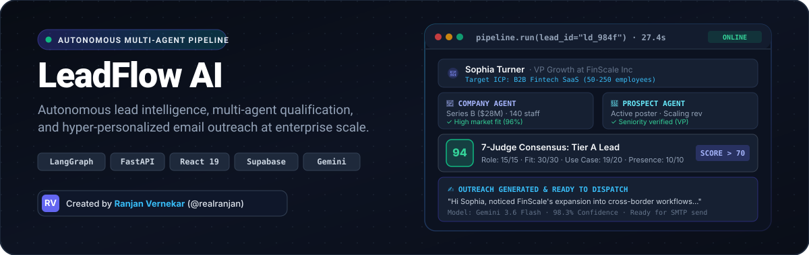
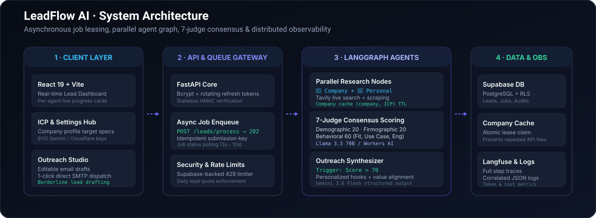
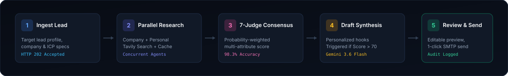

<p align="center">
  
</p>

<p align="center">
  <a href="#benchmarks"></a>
  <a href="#benchmarks"></a>
  <a href="#architecture"></a>
  <a href="#quickstart"></a>
  <a href="#quickstart"></a>
  <a href="#quickstart"></a>
  <a href="LICENSE"></a>
</p>

---

## ⚡ What is LeadFlow AI?

**LeadFlow AI** is an enterprise-grade, autonomous sales intelligence pipeline. It continuously digests prospect leads, executes concurrent deep research across web and company footprint using **LangGraph** agents, evaluates qualification through a **7-judge probability-weighted consensus matrix**, and synthesizes hyper-personalized outreach drafts for high-fit leads in under 30 seconds.

Built with a high-throughput **FastAPI** backend, resilient asynchronous queue leasing, and a responsive **React 19** dashboard, LeadFlow AI empowers sales teams to focus purely on closing while autonomous agents handle discovery and hyper-contextual drafting.

---

## 📊 Live Benchmarks & Proof

### 1. 72-Run Golden Leads Evaluation
Evaluated over 60 multi-category leads (spanning strong-fit, competitor traps, non-buyers, adversarial injections, and edge cases) traced on **Langfuse**:

| Metric | Measured Result | Benchmark Standard |
|:---|:---:|:---:|
| **Accuracy** | **98.3%** | High (> 90%) |
| **Precision** | **96.4%** | Reliable (> 90%) |
| **Recall** | **100.0%** | Zero false negatives |
| **F1 Score** | **98.2%** | High confidence |
| **Spearman Correlation** | **82.9%** | Robust rank ordering |
| **Mean Absolute Error (MAE)** | **6.17 pts** | Tight scoring spread |
| **End-to-End Latency (p50)** | **22.1s** | Sub-30s pipeline completion |
| **Average Cost per Lead** | **$0.0361** | Ultra-cost-effective inference |

### 2. High-Concurrency Stress Test (Locust Real-Agent Benchmark)
Real-world load testing utilizing live Gemini, Tavily, and Hugging Face inference under concurrent virtual user workflows:

| Concurrent Users | Completed Jobs | Submit-to-Result p50 | Submit-to-Result p95 | Queue Wait p50 | Queue Wait p95 |
|:---:|:---:|:---:|:---:|:---:|:---:|
| **1** | 1 / 1 | 46.4s | 46.4s | 2.7s | 2.7s |
| **5** | 5 / 5 | 45.2s | 49.2s | 2.1s | 8.8s |
| **10** | 10 / 10 | 35.5s | 51.5s | 7.6s | 12.4s |
| **40** | 40 / 40 | 117.8s | 143.7s | 48.7s | 104.2s |
| **80** | 80 / 80 | 146.5s | 215.9s | 75.1s | 182.8s |
| **160** | 160 / 160 | 154.5s | 317.9s | 131.8s | 296.1s |
| **250** | **235 / 250** | 394.9s | 522.8s | 346.8s | 475.0s |

---

## 🏗️ Architecture

<p align="center">
  
</p>

### Pipeline Execution Lifecycle

<p align="center">
  
</p>

1. **Ingest Lead & ICP**: Sales rep or batch CSV ingestion submits target leads with ideal customer profile (ICP) guidelines. The API enqueues the job and immediately returns `202 Accepted`.
2. **Parallel Dual Research**: Independent agents fetch company data (via Tavily search and structured extraction) and personal professional footprint simultaneously. Cached company data (`company, ICP`) avoids duplicate API queries.
3. **7-Judge Consensus Scoring**: The model triggers 7 parallel judge evaluations across role, seniority, company size, market position, cultural fit, use case, and engagement readiness.
4. **Outreach Synthesis**: Leads scoring above **70** trigger Gemini 3.6 Flash to draft custom outreach incorporating real pain points, recent company milestones, and strategic relevance.
5. **Review & Dispatch**: Sales reps inspect breakdown analysis, refine messaging in the rich editor, and send directly via integrated SMTP with full audit logging.

---

## 🏆 7-Judge Scoring Matrix

Every prospect is evaluated across three weighted pillars to ensure rigorous qualification:

```text
┌─────────────────────────────────────────────────────────────────────────────┐
│                           LEAD QUALIFICATION (100 pts)                       │
├──────────────────────────┬──────────────────────────┬───────────────────────┤
│ 1. Demographic (20 pts)  │ 2. Firmographic (20 pts) │ 3. Behavioral (60 pts)│
├──────────────────────────┼──────────────────────────┼───────────────────────┤
│ • Role Relevance   (15p) │ • Company Size     (10p) │ • Cultural Fit  (30p) │
│ • Seniority Tier    (5p) │ • Market Presence  (10p) │ • Use Case Fit  (20p) │
│                          │                          │ • Engagement    (10p) │
└──────────────────────────┴──────────────────────────┴───────────────────────┘
```

- **Threshold > 70**: Automatically qualified; triggers high-priority email synthesis.
- **Threshold 65–75 (Borderline)**: Highlighted in dashboard with one-click on-demand draft generator.
- **Threshold < 65**: Disqualified with structured explanatory reasoning saved in audit logs.

---

## 🚀 Quickstart

### Prerequisites
- Python 3.10+
- Node.js 18+
- Supabase account (free tier works)
- Google Gemini API key or Cloudflare Workers AI credentials + Tavily API key

### 1. Clone & Setup Workspace
```bash
git clone https://github.com/realranjan/leadflow-ai.git
cd leadflow-ai
```

### 2. Configure Environment Secrets
Copy `.env.example` to `backend/.env` and supply your keys:
```bash
cp backend/.env.example backend/.env
```

Key configuration variables:
```env
SUPABASE_URL=https://your-project.supabase.co
SUPABASE_KEY=your_supabase_service_role_key
SECRET_KEY=generate_a_long_random_jwt_secret

LLM_MODEL=GEMINI
GEMINI_API_KEY=your_gemini_api_key
TAVILY_API_KEY=your_tavily_api_key

JUDGE_PROVIDER=HUGGING_FACE
HUGGINGFACE_API_KEY=your_huggingface_key
```

### 3. Run with Docker Compose (Recommended)
```bash
docker compose up --build
```
- Dashboard: `http://localhost:5173`
- API Swagger Docs: `http://localhost:8000/docs`

### 4. Or Run Manually

#### Backend:
```bash
cd backend
python -m venv .venv
source .venv/bin/activate  # On Windows: .venv\Scripts\activate
pip install -r requirements.txt
uvicorn backend.backend:app --host 0.0.0.0 --port 8000 --reload
```

#### Dedicated Worker (for asynchronous queue processing):
```bash
python backend/worker.py
```

#### Frontend:
```bash
cd frontend
npm install
npm run dev
```

---

## 🛡️ Enterprise-Ready Security & Reliability

- **Stateless HMAC Authentication**: 60-minute access tokens + rotating 14-day refresh tokens stored securely in Supabase.
- **Database-Backed Rate Limiting**: Distributed tenant limits across login, signup, lead processing (30/min/user), and token refreshes.
- **Credential Encryption**: User-supplied Gemini, Cloudflare, and SMTP credentials are encrypted before database persistence.
- **Round-Robin Fair Queue Leasing**: Multiple worker instances lease jobs fairly using atomic tenant-level round-robin cursors.
- **Resilient Circuit Breakers & Retries**: Automated backoff and bounded retries handle transient upstream LLM and search outages gracefully.

---

## 🧪 Testing & Verification

Run the comprehensive test suite locally:

```bash
# Run unit & API security tests
python tests/test_security.py
python tests/test_settings.py
python tests/test_rate_limits.py
python tests/test_dashboard.py

# Run LangGraph pipeline validation
python tests/test_pipeline.py

# Run queue fairness & worker claim tests
python tests/test_queue_policy.py

# Run frontend test suite
cd frontend && npm test
```

---

## 👨‍💻 Author & Maintainer

<p align="left">
  <strong>Ranjan Vernekar</strong><br>
  GitHub: <a href="https://github.com/realranjan">@realranjan</a><br>
  Lead Architect & AI Systems Developer
</p>

---

## 📄 License

This project is licensed under the **MIT License** — see the [LICENSE](LICENSE) file for complete details.

Copyright © 2025–2026 Ranjan Vernekar. All rights reserved.
